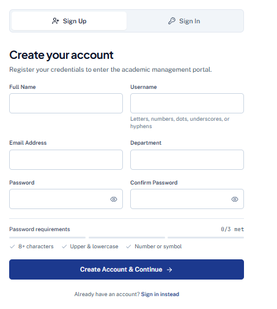

<div align="center">
  
  <h1>University Students Information Management System</h1>
  <p>
    <strong>A full-stack academic registry, financial ledger, and relational database management portal</strong>
    <br />
    Built with React 19, TypeScript, Tailwind CSS v4, Express, and SQLite.
  </p>

  <p>
    <a href="https://ais-pre-nfxqndafvi2dwpvg6bfse6-251001881925.europe-west2.run.app">
      
    </a>
    
    
    
    
    
    <a href="./LICENSE">
      
    </a>
  </p>

  <p>
    <a href="#project-overview">Overview</a> ·
    <a href="#features-and-capabilities">Features</a> ·
    <a href="#architecture-overview">Architecture</a> ·
    <a href="#getting-started">Getting Started</a> ·
    <a href="#usage-instructions">Usage</a> ·
    <a href="#security-awareness">Security</a>
  </p>
</div>

---

## Table of Contents

- [Project Overview](#project-overview)
- [Live Demo](#live-demo)
- [Features and Capabilities](#features-and-capabilities)
- [Visual Previews](#visual-previews)
- [Architecture Overview](#architecture-overview)
- [Technology Stack](#technology-stack)
- [Project Structure](#project-structure)
- [Usage Instructions](#usage-instructions)
- [Security Awareness](#security-awareness)
- [Frequently Asked Questions (FAQ)](#frequently-asked-questions-faq)
- [Contributing Guidelines](#contributing-guidelines)
- [Release Notes & Version History](#release-notes--version-history)
- [License Information](#license-information)
- [Credits and Acknowledgements](#credits-and-acknowledgements)
- [Contact & Support](#contact--support)

---

## Project Overview

The **University Students Information Management System (USIMS)** is a relational database-driven academic administration portal designed for managing core university registry operations from a single workspace.

It unifies student admissions, faculty directories, academic programmes, semester scheduling, course enrollments, examination grading, Kenyan Shilling (`KSh`) tuition ledgers, system configuration, and live SQLite schema inspection/backup workflows—while keeping database integrity rules enforced directly at the database layer via foreign keys, `CHECK` constraints, triggers, and views.

---

## Live Demo

- **Shared Application Preview:** [Launch University Students Information Management System](https://ais-pre-nfxqndafvi2dwpvg6bfse6-251001881925.europe-west2.run.app)

> **First-Time Access Note:** No dummy user accounts or mock student records are shipped in the database. On first launch, create an administrator profile directly on the **Create Account** tab to initialize access.

---

## Features and Capabilities

### Authentication, Recovery & Theme Support
- **Modern Sign In & Create Account Portal:** Responsive split-screen authentication workspace with keyboard-accessible tabs (`ArrowLeft`/`ArrowRight`, `Home`/`End`), real-time validation, inline loading spinners, password strength meters, and show/hide toggles on every password and PIN input.
- **Self-Service Password Reset:** Users can configure an optional **Recovery PIN** during registration or later under **Settings → Security & Sessions**, then verify account ownership on the **Forgot password?** flow to issue a short-lived, single-use reset token that invalidates all prior sessions upon reset.
- **Brute-Force Protection:** Persistent SQLite attempt tracking (`auth_attempts`) locks repeated failed login or recovery attempts with HTTP `429`, `Retry-After` headers, and a live countdown timer in the UI.
- **Light & Dark Theme Support:** Class-based light/dark mode toggle available on both the sign-in screen and the authenticated portal header.

### Academic & Financial Operations
- **Executive Dashboard (`Dashboard`):** Live counts for students, lecturers, courses, registrations, active semester status, total `KSh` tuition collected, recent enrollments, recent payments, and course performance metrics.
- **Student Registry (`Students`):** Full CRUD workflows, auto-generated registration numbers (`<PREFIX>-<YEAR>-<NNN>`), live course-of-study autocomplete, multi-criteria filtering, pagination, and a comprehensive student profile modal (registrations, grades, and fee history).
- **Lecturers & Programmes (`Lecturers` & `Courses`):**
  - Lecturer directory with department filters and assigned workload counters.
  - Pre-seeded catalog of **70 Kirinyaga University academic programmes** spanning five schools (*Business & Education*, *Pure & Applied Sciences*, *Engineering & Technology*, *Health Sciences*, and *Hospitality & Textile Technology*), filterable by qualification level (`Bachelor's`, `Diploma`, `Certificate`, `Post Graduate Diploma`), with full CRUD management and course rosters.
- **Semesters & Course Registrations (`Semesters` & `Registrations`):**
  - Term lifecycle tracking (`Active`, `Upcoming`, `Completed`) enforcing a single active semester at a time.
  - Per-semester enrollment management with database-level duplicate registration prevention.
- **Examinations & Automated Grading (`Examinations`):** Record exam and assignment scores (`0–100`) with SQLite validation and calculation triggers that automatically compute weighted totals, letter grades (`A`–`E`), and `Pass`/`Fail` remarks.
- **Fee Payments Ledger (`Fee Payments`):** Track tuition payments in `KSh` (or `KES`) across M-Pesa, Bank Transfer, EFT, Cheque, Card, and Cash with unique transaction reference enforcement.
- **Database & SQL Lab (`Database & SQL Lab`):** Inspect live tables, indexes, triggers, and views; run query-plan demonstrations; verify constraint enforcement; inspect reference SQL scripts under [`database/`](./database); and export or restore `.sql` backups.
- **Account & System Settings (`Settings`):** Manage profile details, password changes, Recovery PIN setup, active session revocation, institutional defaults (`reg_number_prefix`, default credit hours, payment method, currency), and customizable grading thresholds.

---

## Visual Previews

| Campus Login Experience | Registration Form Layout |
| :---: | :---: |
|  |  |
| *Split-panel campus photography framing the authentication workspace* | *Registration form with real-time validation and password requirements* |

---

## Architecture Overview

```text
+-------------------------------------------------------------------+
|                     React 19 + Vite SPA (src/)                    |
|  AuthView · Dashboard · Students · Courses · Exams · Payments     |
|  - Bearer session token stored strictly in JS memory (src/api.ts) |
|  - Class-based Light / Dark theme & Tailwind CSS v4               |
+---------------------------------+---------------------------------+
                                  | HTTPS / JSON (/api/*)
                                  v
+-------------------------------------------------------------------+
|                 Express Application Server (server.ts)            |
|  - server/auth.ts   : scrypt hashing, HMAC-SHA256 sessions,       |
|                       429 brute-force lockouts, PIN reset flow    |
|  - server/routes.ts : Academic CRUD, settings, SQL Lab, backups   |
+---------------------------------+---------------------------------+
                                  | Parameterized Queries
                                  v
+-------------------------------------------------------------------+
|             SQLite Database (data/university_student.db)          |
|  - Relational schema with FOREIGN KEY, UNIQUE & CHECK constraints |
|  - Triggers (exam score validation & auto grade calculation)      |
|  - Views & B-Tree indexes + backups/ (.sql export & restore)      |
+-------------------------------------------------------------------+
```

---

## Technology Stack

| Layer | Technologies | Reference |
| :--- | :--- | :--- |
| **Frontend UI** | React 19, TypeScript, Tailwind CSS v4, Lucide React | [`package.json`](./package.json) |
| **Build & Tooling** | Vite 8, `tsx`, `esbuild`, TypeScript (`tsc`) | [`vite.config.ts`](./vite.config.ts) |
| **Backend API** | Node.js (20+), Express 4, `dotenv`, Node `crypto` | [`server.ts`](./server.ts) |
| **Database Engine** | SQLite via `better-sqlite3` (WAL mode, triggers, views, indexes) | [`server/db.ts`](./server/db.ts) |

---

## Project Structure

```text
├── database/                  # Reference SQL definitions (schema, views, triggers, indexes, security)
├── public/
│   ├── assets/                # Static preview assets
│   └── logo.svg               # Official vector emblem
├── server/
│   ├── auth.ts                # Auth routes, scrypt/HMAC helpers, brute-force lockouts & PIN reset
│   ├── db.ts                  # SQLite initialization, triggers, views, migrations & course seed
│   └── routes.ts              # Academic module endpoints, settings, SQL Lab & .sql backups
├── src/
│   ├── assets/images/         # Campus photography used on AuthView
│   ├── components/            # Modular UI views (AuthView, DashboardView, StudentsView, etc.)
│   ├── api.ts                 # In-memory Bearer token client & structured ApiError handler
│   ├── App.tsx                # Root state, auth bootstrap & theme management
│   ├── index.css              # Tailwind CSS v4 theme configuration & reduced-motion animations
│   └── types.ts               # Shared TypeScript interfaces
├── .env.example               # Safe environment variable template (placeholders only)
├── LICENSE                    # MIT License
├── README.md                  # Project documentation
├── SECURITY.md                # Security policy and vulnerability reporting
├── package.json               # Scripts and dependencies
└── server.ts                  # Express + Vite middleware entrypoint
```

---

## Usage Instructions

1. **Create the Initial Account:** Open `http://localhost:3000`, fill out the **Create Account** form, and optionally set a **Recovery PIN** (`4–24` characters) for self-service password resets.
2. **Configure Institutional Preferences:** Open **Settings** from the sidebar or top header to customize the institution name, registration number prefix (for example `KYU` → `KYU-2026-001`), currency label (`KSh` / `KES`), and examination grading weights.
3. **Set Up Academic Terms & Faculty:** Add an `Active` academic term under **Semesters** and register faculty members under **Lecturers** before assigning courses.
4. **Enroll Students & Record Marks:** Add students under **Students**, register them into courses under **Registrations**, and record marks under **Examinations**—weighted totals and grades update automatically via SQLite triggers.
5. **Track Tuition & Backups:** Log `KSh` fee receipts in **Fee Payments** and download `.sql` snapshots anytime from **Database & SQL Lab**.

---

## Security Awareness

The application implements defense-in-depth practices at both the authentication and database layers:

- **Password & Recovery PIN Hashing:** Credentials and recovery PINs are hashed with salted Node `crypto.scryptSync` and verified via constant-time `crypto.timingSafeEqual` (including dummy hash verification when an account identifier is not found).
- **In-Memory Session Handling:** Session bearer tokens are generated with `crypto.randomBytes(32)`, stored server-side only as `HMAC-SHA256` digests in `auth_sessions`, and kept strictly in JavaScript memory (`src/api.ts`) rather than `localStorage` or `sessionStorage`.
- **Brute-Force & Rate-Limit Controls:** Persistent SQLite attempt counters (`auth_attempts`) throttle repeated failed logins, password resets, and rapid automated registrations with HTTP `429` lockouts and `Retry-After` headers.
- **Single-Use Password Resets:** Verified PIN resets issue a 10-minute, single-use reset token (`password_reset_tokens`) and revoke all existing active sessions when the password changes.
- **SQL Injection Prevention:** Server routes use parameterized `better-sqlite3` prepared statements alongside database-level `CHECK`, `UNIQUE`, and `FOREIGN KEY` constraints.

---

## Frequently Asked Questions (FAQ)

<details>
<summary><strong>Does the system ship with default login credentials or sample students?</strong></summary>

No. Only the catalog of 70 Kirinyaga University academic programmes and default portal/grading configuration rows are initialized automatically. All user accounts, students, lecturers, and financial records start empty until you create them.

</details>

<details>
<summary><strong>How do I reset a forgotten password?</strong></summary>

Click <strong>Forgot password?</strong> on the Sign In screen, enter your username or email alongside your configured <strong>Recovery PIN</strong>, and choose a new password. If you have not set a Recovery PIN yet, sign in and configure one under <strong>Settings → Security &amp; Sessions</strong>.

</details>

<details>
<summary><strong>How are examination totals and letter grades calculated?</strong></summary>

SQLite triggers (<code>trg_exam_calc_insert</code> and <code>trg_exam_calc_update</code>) automatically compute weighted totals, letter grades (<code>A</code>–<code>E</code>), and <code>Pass</code>/<code>Fail</code> remarks whenever marks are inserted or updated, using the policy configured under <strong>Settings → Grading Policy</strong>.

</details>

<details>
<summary><strong>Where is application data persisted?</strong></summary>

Data is stored locally in SQLite (<code>data/university_student.db</code>) with WAL journaling enabled, and exported SQL snapshots can be generated or restored from <strong>Database &amp; SQL Lab</strong>.

</details>

---

## Contributing Guidelines

Contributions that improve reliability, accessibility, documentation, or security are welcome:

1. **Fork & Branch:** Create a focused feature or fix branch from `main` (for example, `feat/transcript-export` or `fix/registration-validation`).
2. **Follow Code Standards:** Keep TypeScript strict, parameterize all SQL queries, preserve light/dark theme parity, and avoid committing generated artifacts or secrets.
3. **Verify Locally:** Ensure both `npm run lint` and `npm run build` succeed cleanly without warnings or errors.
4. **Open a Pull Request:** Describe the motivation, affected modules, and manual or automated verification steps clearly—without including any personal data or credentials.

---

## Release Notes & Version History

This project tracks ongoing improvements directly in repository commits rather than a separate `CHANGELOG.md` file yet. Recent milestones include:

- **Authentication & Security Upgrade:** Upgraded Sign In/Create Account UX, dark/light theme support, self-service Recovery PIN password resets, persistent SQLite brute-force lockouts, and Settings security controls.
- **Academic Portal & Kirinyaga University Catalog:** Added pre-seeded 70-programme course catalog, configurable institutional settings, `KSh` fee ledger, and SQL Lab backup/restore tools.

---

## License Information

This project is distributed under the **MIT License**. See [`LICENSE`](./LICENSE) for full terms and conditions.

---

## Credits and Acknowledgements

- Academic programme catalog structured around faculties and programmes offered at University.
- Built with open-source tooling including [React](https://react.dev/), [Vite](https://vite.dev/), [Tailwind CSS](https://tailwindcss.com/), [Express](https://expressjs.com/), [better-sqlite3](https://github.com/WiseLibs/better-sqlite3), and [Lucide Icons](https://lucide.dev/).

--

## Contact & Support

- **Maintainer Contact:** [marvinfrank2680@gmail.com](mailto:marvinfrank2680@gmail.com)
- **Security Disclosures:** Please follow the responsible reporting process in [`SECURITY.md`](./SECURITY.md) rather than posting sensitive issues publicly.
